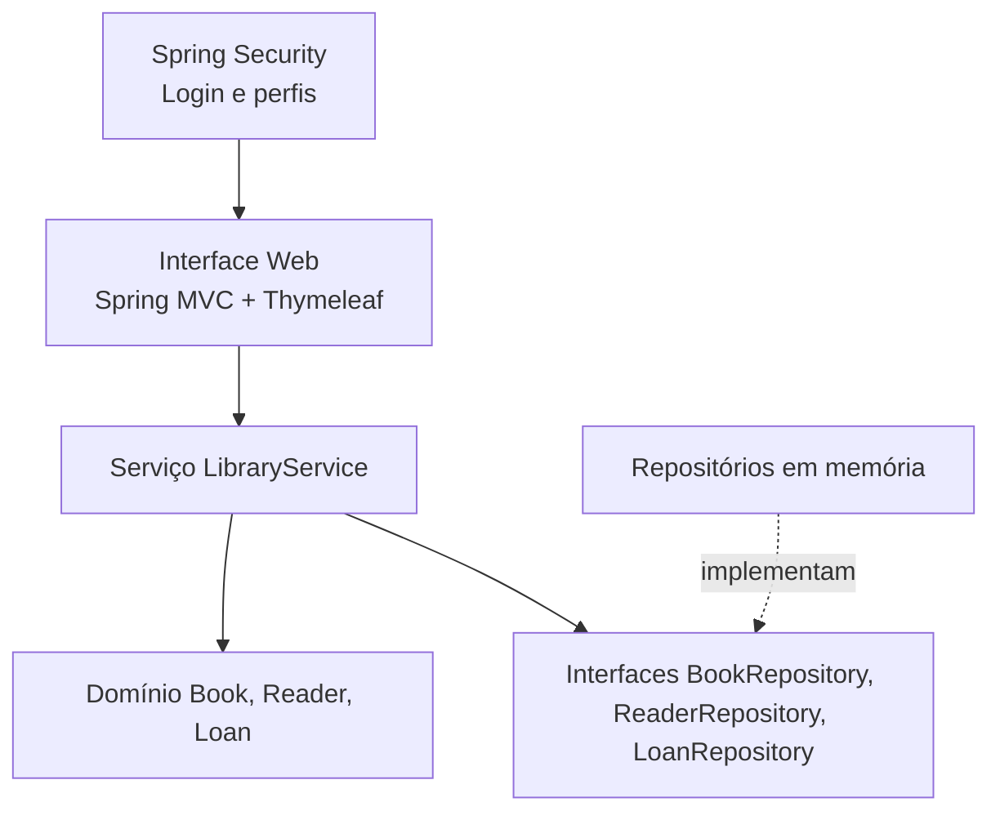
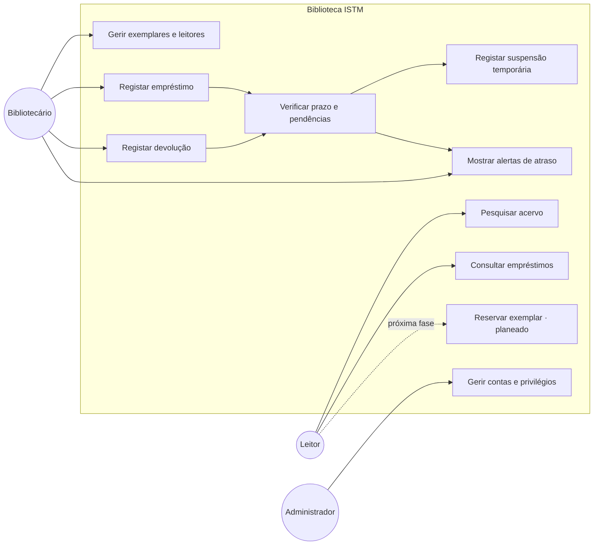
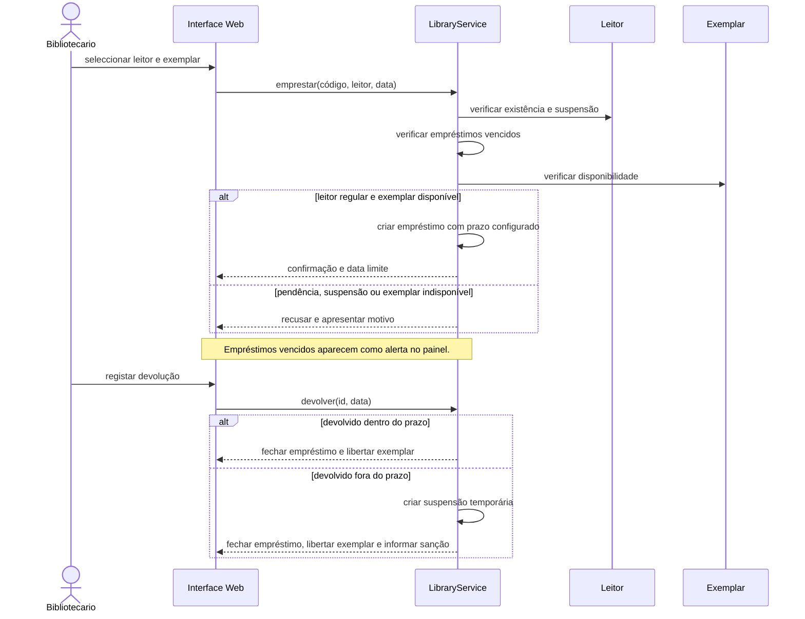
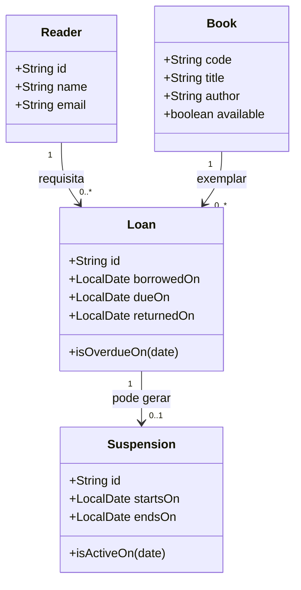

# Arquitectura e requisitos

## Problema e âmbito

A Biblioteca ISTM precisa de registar livros e leitores e controlar a circulação dos livros. Esta versão implementa o catálogo, o registo de leitores e o ciclo de empréstimo e devolução. As regras institucionais de prazo, renovação e limite de empréstimos ainda carecem de decisão.

## Arquitectura em camadas

O navegador apresenta páginas HTML e envia formulários ao controlador Spring MVC. Spring Security exige autenticação e aplica os perfis Administrador e Bibliotecário antes de o controlador chamar `LibraryService`. Thymeleaf gera as páginas no servidor e CSS define o aspecto responsivo. O serviço executa os casos de uso e valida regras de empréstimo; as entidades protegem as suas invariantes. Os contratos Repository isolam o armazenamento e os adaptadores actuais guardam registos em mapas em memória. `LibraryFactory` compõe esses adaptadores.

## Casos de uso (alinhamento com os diagramas de referência)

As contas existentes são de colaboradores. Pesquisa por leitor autenticado, histórico individual e reservas ficam planeados, porque exigem credenciais de leitores e regras de fila ainda não definidas. Alertas aparecem no sistema; envio externo de notificações não está ligado. Pagamentos e multas monetárias foram excluídos conforme a orientação dada em aula.

## Sequência do empréstimo e atraso

## Modelo de domínio actual

## Justificação do estilo

As camadas favorecem a **manutenibilidade**: interface, regras e armazenamento têm responsabilidades distintas. A apresentação Web pode ser alterada nos templates e no CSS sem reescrever as regras. Favorecem também a **testabilidade**: os serviços podem receber repositórios diferentes e as implementações em memória permitem testes rápidos sem infraestrutura externa.

Microserviços poderiam escalar componentes de forma independente, mas acrescentariam comunicação de rede, implantação e observabilidade que não se justificam para o âmbito pequeno e local desta aplicação. Uma arquitectura orientada a eventos ajudaria a desacoplar reacções assíncronas, mas o fluxo actual é síncrono e curto. A arquitectura em camadas mantém menor complexidade operacional e cobre as necessidades de manutenção e testes do problema.

## Requisitos funcionais implementados

| ID | Requisito | Estado |
| --- | --- | --- |
| RF01 | Registar e listar exemplares; impedir código interno duplicado | Implementado |
| RF02 | Registar e listar leitores; validar campos e e-mail | Implementado |
| RF03 | Consultar exemplar por código interno e leitor por identificador | Implementado |
| RF04 | Consultar disponibilidade do livro | Implementado |
| RF05 | Emprestar apenas livros disponíveis a leitores existentes | Implementado |
| RF06 | Devolver apenas empréstimos activos | Implementado |
| RF07 | Registar a data e consultar empréstimos | Implementado |
| RF08 | Calcular prazo de devolução configurável e detectar atraso | Implementado |
| RF09 | Suspender temporariamente novo empréstimo após devolução tardia | Implementado |
| RF10 | Alertar bibliotecário sobre empréstimos em atraso e suspensões activas | Implementado |
| RF11 | Autenticar colaboradores e separar privilégios de administrador e bibliotecário | Implementado |
| RF12 | Pesquisar exemplares e leitores | Implementado |

## Requisitos não funcionais

- Java 17 e Maven.
- Domínio, serviços e acesso a dados separados.
- Persistência substituível através de interfaces de repositório; implementação inicial em memória.
- Palavras-passe codificadas com BCrypt, sessão de autenticação, controlo por perfil e protecção CSRF.
- Sanção aplicada é suspensão temporária; não há pagamento nem multa monetária.
- Testes JUnit 5 executados por Maven.
- Cobertura mínima de 70% das linhas no pacote de negócio, medida por JaCoCo.
- Pipeline GitHub Actions descrito em `.github/workflows/ci.yml` para validar futuras integrações.

## Limites actuais

O armazenamento em memória não conserva dados entre execuções. O sistema não é multiutilizador distribuído e a sincronização das operações está limitada à instância de serviço. Os prazos actuais são valores de demonstração configuráveis, ainda sujeitos a confirmação institucional. Reservas, histórico do leitor, notificações externas e matrículas de leitores para login estão no backlog; as contas implementadas são de colaboradores.
